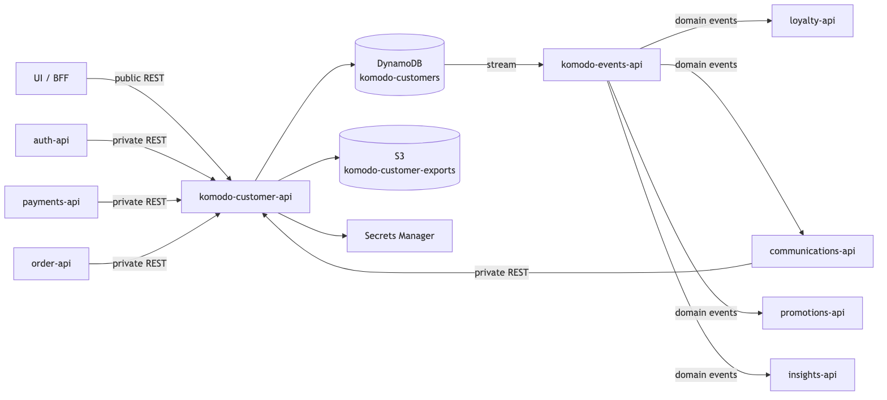
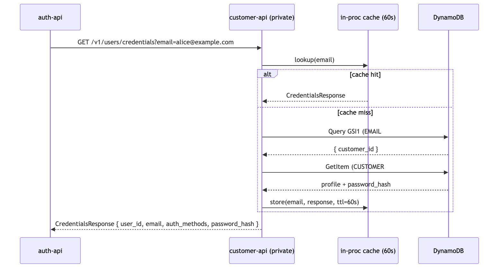
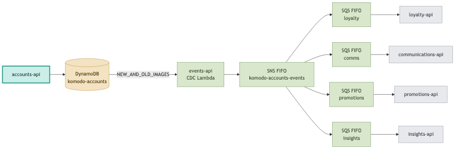
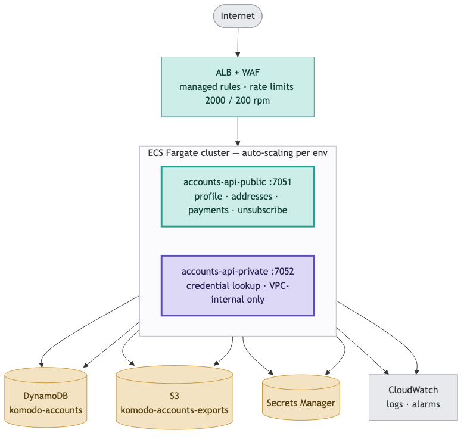

# Software Design Document (SDD) — Komodo Accounts API

## Owners

- **Author(s):** Komodo
- **Status:** In Progress

---

## 1. System Context

**Executive Summary**

Accounts API is the single trusted record of who a Komodo customer is — their profile, saved addresses, saved payment methods, and the credentials that let them sign in without a password. Every customer feels this system directly, whether they notice it or not: a fast sign-in on every visit, a checkout that already knows their address and card, and a deletion request that actually deletes. It also carries real legal weight — this is where Komodo makes good on its privacy commitments under GDPR and equivalent US law, so getting account closure and data export right is regulatory exposure, not a nice-to-have.

### 1.1 Overview

Accounts API is the canonical store for account identity data: profiles, account settings, passkey public keys, preferences, address books, payment-method references, and consent history. It is a data store, not an authenticator — auth-api owns token issuance and credential verification, and every design choice in this service defers to that boundary rather than blurring it.

Both planes are served by the same deployable service — one artifact, two listeners, so the public and private surfaces can never drift apart in version.

| | Public | Private |
|---|---|---|
| Listener | Public listener, internet-facing | Private listener, internal-only |
| Exposure | Reachable from the internet, behind a load balancer and a web application firewall | Reachable only from inside Komodo's private network — sibling services only |
| Callers | The web/app front end, on behalf of a signed-in customer | Sibling Komodo services (auth-api, payments-api, order-api, communications-api) |
| Auth | Customer access token, signature-verified on every request | Service access token, issued through machine-to-machine credential exchange, signature-verified on every request |
| Surface | Profile (including avatar upload), settings, addresses, payments (display-safe view only), preferences, consent, account closure, data export, unsubscribe verification | Credential read/write, passkey lifecycle, payment-method read, settings and tag writes, unsubscribe-token issuance |
| Rate limiting | Global and per-route limits, enforced at the network edge and in-process | Trusted callers only; no public-style limiter |

 

**Components:**

| Component | Responsibility |
|---|---|
| Service bootstrap | Loads configuration and secrets, wires dependencies, registers routes, starts both listeners |
| Request-handling layer (per resource) | Translates each incoming request — profile, settings, passkey, address, payment, preferences, consent, export, unsubscribe — into a service-layer call and a response |
| Service / orchestration layer | Enforces business invariants (one default address or payment method, tag-ownership rules), coordinates changes that touch more than one record, and decides when a domain event should fire |
| Data-store adapter | Translates service-layer calls into reads and writes against this service's own database |
| In-process cache | Short-lived in-memory cache in front of the hottest reads (profile, credentials) |
| Shared internal library layer | Common building blocks used across Komodo services: request handling, authentication/authorization middleware, rate limiting, error handling, secrets access, database access, logging, health checks |

### 1.2 Critical Paths

**Credential lookup — the sign-in hot path.** auth-api calls this service on every sign-in attempt to resolve a customer's credentials. A missing account and a lookup failure return distinct, unambiguous signals so auth-api can react correctly to each. The full round trip is budgeted at roughly 100 milliseconds for nearly all requests — every customer feels this number, because it sits directly on the critical path between "enter email" and "you're in."

**Passkey lifecycle — private, auth-api only.** auth-api can list every device-based credential registered to an account, register a new one, update it after a successful sign-in (so the service can detect a compromised or cloned device on the next attempt), and remove one. Only the public half of each credential is ever stored — private key material never reaches this service, by design.

**Profile management.** Customers and sibling services can create, read, and update a profile. Every update is partial: fields left out of a request are left untouched. Creation and update timestamps are stamped automatically. A change to a customer's email is detected and announced as its own event, separately from other profile changes, because email changes trigger their own downstream handling elsewhere in Komodo. Address and payment methods are the one exception to "partial update" — each write replaces the record whole, since they arrive as complete records from the customer or a payment processor rather than as field-by-field edits.

**Avatar upload.** A customer requests a 15-minute upload link — capped at a small file size and restricted to standard image formats — and uploads their photo directly to storage, without routing the image through this service's own compute. This keeps upload cost and latency off this service's critical path. An account holds exactly one photo at a fixed location, so a new upload replaces the previous one and an account's photo storage can never grow beyond a single file no matter how often the link is used. Storage itself is locked down to private, encrypted, secure-transport-only access; there is no public read path to any stored photo. The link is time-limited, not single-use — it works repeatedly until it expires, which is why bounding what a single upload can write is the control that matters.

**Account closure & right to erasure (US and EU privacy law).** Closure is immediate and irreversible: one request, one operation, everything gone. A recovery period was deliberately removed — the law bounds how long erasure may take, not how long it must be delayed, and holding a customer's data for weeks after they asked for it deleted works against the right rather than for it.

| Step | Trigger | Action |
|---|---|---|
| 1. Confirm | Customer requests account closure | The request must carry proof of intent; without it the request is rejected outright and nothing is removed |
| 2. Erase | Confirmation accepted | Every piece of data tied to the account — records, exported files, and the stored photo alike — is removed in one operation; the email address is released for reuse; cached copies are invalidated; an event announces the completed erasure |

Because erasure now happens while the customer waits rather than in a background job, the completeness of that single operation is the guarantee the whole design rests on. A closure that only partly succeeds must report failure rather than success, and an unusually large account is the case that has to be handled explicitly rather than assumed away.

**Proof of intent.** Today the request must carry the account's own email address back to the service, which is checked against the stored value. A second control — requiring the customer to have signed in within the last few minutes — is specified but not yet active, because it depends on the login system recording when sign-in happened, which it does not do today. Shipping that check before the login system supports it would reject every closure request, so it waits.

**Data download — right to access (US and EU privacy law).** A customer can request a complete, portable export of everything tied to their account. Private credential material is stripped before the export is written. The result is delivered as a single file behind a 15-minute download link. Export is a separate action a customer takes on their own, not a step inside closure: a customer who wants their data before closing requests it first and receives it, and closure neither produces nor waits on a copy. This service does not send email, so making closure wait on delivery confirmation would mean holding a request open across two systems.

**Public unsubscribe.** A customer can opt out of a communications channel by following a link that carries a signed, tamper-evident, time-limited token rather than requiring them to be signed in — appropriate, since unsubscribe links are opened from an email client with no active session. A successful verification is recorded as a new consent entry; the token itself leaves no separate row in the database, only the resulting consent record. The link-minting action is available only to Komodo's messaging system, on a customer's behalf. The token stays valid for 30 days, tuned to match how long a typical customer leaves an email unread before acting on it; a much shorter window would generate support tickets from customers whose link "stopped working."

### 1.3 Edge Cases

- **A credential lookup happens moments after a credential update.** The cache in front of that lookup is cleared on update, so the change is visible immediately on the instance that handled it. The cache lives inside each running copy of the service, so another copy may still serve the previous value until its own entry ages out — bounded by the refresh window in §2.5.3 and accepted as within the freshness budget.
- **An account is suspended or closed while a sign-in lookup is cached.** Any change to an account's lifecycle status must clear the cached sign-in answer for that account. Without it, a suspended account keeps signing in successfully until the entry ages out, which turns a security control into a delayed one.
- **A passkey sign-in attempt reports a lower usage counter than what's on file.** This is a strong signal of a cloned or replayed credential, so it's rejected outright at the storage layer, and the caller (auth-api) receives a clear conflict signal rather than a silent accept.
- **A single account's erasure touches an unusually large number of records.** The erasure runs as a series of atomic batches; each batch is all-or-nothing, but a very large account (rare) is not guaranteed to erase atomically end-to-end in a single step. Now that erasure happens while the customer waits rather than in a background job, a batch failing partway must surface as a failed request that can be safely retried — not a warning logged behind a success. At realistic per-account volumes the whole erasure fits in one or two batches; the outlier is what this rule exists for.
- **An account tries to sign in immediately after closure.** No longer a question: there is no recoverable window and no intermediate state, so the account and its credentials are simply gone and the sign-in lookup returns "no such account". This removes what was previously an open cross-team decision for the login system.
- **An unsubscribe link is used more than once.** The second use is checked against the most recent consent record for that channel and treated as a harmless repeat — no duplicate record, no duplicate event.
- **Two callers try to change the same account at once** — for example, two systems updating account status simultaneously, or two requests both trying to set a new default address or payment method. Settings changes are guarded so a conflicting write is rejected and the caller must re-fetch and retry, rather than silently overwriting another system's change. Default-address and default-payment switches happen as a single atomic operation, so a customer can never end up with two defaults, or none.

---

## 2. Design & Architecture

### 2.1 Endpoints

| Endpoint | Method | Plane | Purpose |
|---|---|---|---|
| `/health` | GET | both | Liveness check |
| `/health/ready` | GET | both | Readiness check — confirms the data store is reachable |
| `/v1/accounts/exists` | GET | public | Check if an email is registered (rate-limited oracle) |
| `/v1/me/profile` | GET | public | Get authenticated account's profile |
| `/v1/me/profile` | POST | public | Create account record (registration) |
| `/v1/me/profile` | PUT | public | Update authenticated account's profile (partial) |
| `/v1/me/profile` | DELETE | public | Account closure / right-to-delete — immediate, irreversible, confirmation required |
| `/v1/me/profile/export` | POST | public | Data download / right-to-access |
| `/v1/me/profile/email` | PUT | public | Change email address — **stub, 501** |
| `/v1/me/profile/avatar` | POST | public | Get avatar upload link (time-limited) |
| `/v1/me/profile/avatar` | DELETE | public | Remove the avatar image and its stored object — **stub, 501** |
| `/v1/communications/unsubscribe` | POST | public | Verify unsubscribe token and record consent opt-out |
| `/v1/me/consents` | GET | public | List own marketing consent history — **stub, 501** |
| `/v1/me/consents` | POST | public | Record an own marketing consent decision — **stub, 501** |
| `/v1/me/addresses` | GET | public | List all addresses for the authenticated account |
| `/v1/me/addresses` | POST | public | Add a new address |
| `/v1/me/addresses/{id}` | GET | public | Get a single address — **stub, 501** |
| `/v1/me/addresses/{id}` | PUT | public | Update an address (partial) |
| `/v1/me/addresses/{id}` | DELETE | public | Delete an address |
| `/v1/me/payments` | GET | public | List saved payment methods |
| `/v1/me/payments` | PUT | public | Add or update a payment method (upsert) |
| `/v1/me/payments/{id}` | GET | public | Get a single payment method — **stub, 501** |
| `/v1/me/payments/{id}` | DELETE | public | Remove a payment method |
| `/v1/me/preferences` | GET | public | Get account preferences |
| `/v1/me/preferences` | PUT | public | Update account preferences (partial) |
| `/v1/me/settings` | GET | public | Own verification + lifecycle state, tags excluded — **stub, 501** |
| `/v1/accounts/{id}` | GET | private | Get profile by account ID (service-to-service) |
| `/v1/accounts/{id}/addresses` | GET | private | Get addresses for an account (service-to-service) |
| `/v1/accounts/{id}/preferences` | GET | private | Get preferences for an account (service-to-service) |
| `/v1/accounts/{id}/payments` | GET | private | Get payment methods for an account (service-to-service) |
| `/v1/accounts/credentials` | GET | private | Get credentials for login verification (service-to-service, auth-api hot path) |
| `/v1/accounts/{id}/credentials` | PUT | private | Set or rotate account credentials (service-to-service) |
| `/v1/accounts/{id}/passkeys` | GET | private | List passkey credentials for an account (service-to-service) |
| `/v1/accounts/{id}/passkeys` | POST | private | Create a passkey credential record (service-to-service) |
| `/v1/accounts/{id}/passkeys/{credential_id}` | PATCH | private | Update a passkey credential record (service-to-service) |
| `/v1/accounts/{id}/passkeys/{credential_id}` | DELETE | private | Delete a passkey credential record (service-to-service) |
| `/v1/accounts/{id}/settings` | GET | private | Get account settings |
| `/v1/accounts/{id}/settings` | PUT | private | Update account settings (partial) |
| `/v1/accounts/{id}/settings/tags` | PUT | private | Update account tags (namespace-restricted) |
| `/v1/accounts/{id}/communications/unsubscribe-token` | POST | private | Mint stateless unsubscribe token |

`openapi.yaml` is the versioned contract source of truth for request/response shapes and the full error catalog — this table is a map of what exists, not a substitute for it.

Rows marked **stub, 501** have a registered route, a published contract entry, and a handler that
authenticates the caller and then returns `501 Not Implemented`. They are reserved surface, not
working features; implementation is tracked in `TODO.md` §26. Two routes were retired rather than
stubbed: `POST /v1/me/profile/restore` (no longer meaningful once erasure became immediate and
irreversible — ADR 001 D3) and `DELETE /v1/me/preferences` (no customer-facing meaning; it left an
account with no language or timezone).

**Consumer map**

| Consumer | Pattern | Surface |
|---|---|---|
| auth-api | Private REST (hot path) | `GET /v1/accounts/credentials`, `PUT /v1/accounts/{id}/credentials`, passkey CRUD |
| payments-api | Private REST | `GET /v1/accounts/{id}/payments` — display-safe summaries only; the payment processor's own credential is held by payments-api, never by this service |
| order-api | Private REST | `GET /v1/accounts/{id}/addresses`, `…/profile` |
| communications-api | Private REST + events | profile, consent, preferences reads; unsubscribe-token mint; subscribes to `account.*` events |
| loyalty-api | Events + private REST | Subscribes to `account.registered`, `account.deleted`, `account.status_changed`; writes its own tags via the settings-tags route |
| promotions-api | Events + private REST | Subscribes to `account.consent_changed`, `account.tags_changed`; writes its own tags |
| insights-api | Events | Subscribes to all `account.*` events |

### 2.2 Data Modeling

This service stores account data in a single, purpose-built data store, plus two separate file-storage areas — one for time-limited data-export files (7-day retention), one for durable profile photos with no expiry. This service owns that data store outright: it defines the full structure, the lookup indexes, the point-in-time backup and encryption settings, and deletion protection, so the schema and the infrastructure that runs it can never drift apart. That's a deliberate discipline — a database defined in one place and used from another is a common source of hard-to-diagnose outages.

Every account's data is grouped together internally by account, with each record type — profile, settings, passkey, address, payment method, preferences, consent event — stored as a distinct, independently updatable item under that account. Full schema detail lives in §5.

A secondary lookup index, built only over profile records and keyed by a normalized email address, is what makes the sign-in credential lookup fast — it avoids scanning an account's entire set of records on every login attempt. That index currently exposes only the account identifier; widening what it returns later requires rebuilding it, not just reconfiguring it, so its scope was chosen deliberately up front.

Full item-level attribute schemas, ID formats, and file-storage configuration (encryption, lifecycle, download-link expiry, access control) live in §5. A short-lived in-process cache fronts profile and credential reads only.

**Stream → events-api fan-out**

Every change to account data automatically feeds a company-wide change-detection pipeline, which events-api owns end-to-end — including the message-distribution system and the delivery queues that fan changes out to subscribers. This service's only responsibility is exposing that stream of changes; it never calls out to other systems directly to announce an event. Every event this service produces is tagged with its origin and a version number, so consumers always know where an event came from and how to read it.

| Event | Trigger | Payload key fields |
|---|---|---|
| `account.registered` | New account created | `account_id`, `email`, `created_at` |
| `account.deleted` | Final, irreversible erasure completes | `account_id`, `deleted_at` |
| `account.profile_updated` | Profile changed (fields other than email or phone) | `account_id`, `changed_fields[]`, `updated_at` |
| `account.email_changed` | Email address changed | `account_id`, `old_email`, `new_email`, `updated_at` |
| `account.phone_changed` | Phone number changed | `account_id`, `old_phone`, `new_phone`, `updated_at` |
| `account.consent_changed` | A new consent decision is recorded | `account_id`, `channel`, `action`, `source`, `recorded_at` |
| `account.preferences_updated` | Preferences saved | `account_id`, `language`, `timezone`, `communication`, `updated_at` |
| `account.status_changed` | Account lifecycle status changes | `account_id`, `old_status`, `new_status`, `status_reason`, `status_changed_at` |
| `account.tags_changed` | Internal account labels change | `account_id`, `added[]`, `removed[]`, `updated_at` |
| `account.passkey_added` | A new sign-in credential is registered | `account_id`, `credential_id`, device metadata, `created_at` |
| `account.passkey_removed` | A sign-in credential is removed | `account_id`, `credential_id`, `removed_at` |

Full per-event derivation notes — how each event is computed from the underlying change, and when multiple events fire together — live in §6.

### 2.3 Business Logic

- **Every write is guarded against a create/update collision.** The storage layer enforces this at the lowest level, underneath every other rule below — it's the baseline correctness guarantee everything else builds on.
- **Every resource update is partial, except payment methods.** A field left out of an update request is left unchanged; a field explicitly sent as empty is written as empty — the two are distinguished, not conflated. This applies to profile, address, preferences, and settings. Payment methods are the deliberate exception: each write replaces the record whole, because payment data arrives as a complete, write-once record from the payment processor, not as a field-by-field edit.
- **Account settings use a stricter conflict-safe write; profile and preferences do not.** Settings can be written by several different Komodo systems (loyalty, marketing, support, and this service itself), so a conflicting simultaneous write is rejected outright and the caller must re-fetch and retry — silently letting the last writer win would lose another system's change. Profile and preferences are edited almost exclusively by the account owner one at a time, so the extra guard isn't worth its cost there; last-write-wins is accepted.
- **Switching the default address or payment method is a single, all-or-nothing operation.** The old default is demoted and the new one promoted in one atomic step, which guarantees a customer can never end up with two defaults, or none — the failure mode a naive "read, then update" approach would allow, and the direct cause of "wrong address shipped" or "no default at checkout" support tickets.
- **A passkey sign-in attempt reporting a used-before counter is rejected outright, not just logged.** This is a strong signal of a cloned or compromised credential, so the write is refused and the caller is told there was a conflict rather than the anomaly being silently accepted.
- **Which internal system can attach which label to an account is restricted by ownership.** A caller's identity is established from its own service credentials — never trusted from the request itself — and checked against an allow-list of label categories each system is permitted to write:

  | System | Allowed to write |
  |---|---|
  | Loyalty | Loyalty-related labels only |
  | Marketing / promotions | Marketing-related labels only |
  | Customer support | Support-related labels only |
  | This service (self / admin) | System-level labels only |

  A write outside a system's allowed category is rejected outright.
- **A middle name or initial is deliberately not modeled as an account field.** No business logic depends on it today; if shipping ever needs it, it belongs on the address record, not on identity.
- **Marketing consent and day-to-day communication preferences are two separate systems of record, and they are never reconciled.** One is a simple current-state toggle per channel; the other is a permanent, append-only history of every opt-in and opt-out. Keeping them separate is deliberate — the history exists specifically so Komodo can prove what a customer consented to and when, which the current-state toggle alone could never do.

### 2.4 Security and Governance

| Threat | Control |
|---|---|
| Unauthorized profile access | Every request requires a valid, signed access token; a customer's identity is always taken from their own verified token, never from a value they supply in the request path — closing off a class of "access someone else's account by editing the URL" attacks |
| Payment data exposure | The processor's card reference is never included in any response except the one internal, tightly-scoped route built for the payments system to read it, which itself requires a verified service credential |
| Personal data in logs | Logs carry only an account identifier — never a name, email, or phone number — enforced as a standing redaction rule |
| Incomplete legal erasure | Erasure runs as a series of atomic, all-or-nothing batches across every piece of the account's data, including exported files and the stored photo, in the single operation that performs closure; an unusually large account (over roughly 100 records) spans more than one batch, and a batch failing partway reports a failed request that can be safely retried rather than a success with data left behind |
| Irreversible closure by mistake or stolen session | Closure cannot be undone, so the request must prove intent before it is honored: today by carrying the account's own email address, and in future additionally by requiring a sign-in within the last few minutes. An unconfirmed request is rejected outright |
| Account enumeration (registration check) | The "is this email already registered" check is a deliberate, narrow exception built for the sign-in screen, and it's throttled to roughly one request per second per caller — far tighter than any other public route — to prevent it being abused to mass-verify email addresses |
| Account enumeration (credential lookup) | The credential lookup used by sign-in returns a distinct signal for "no such account" versus "lookup failed," but reveals nothing else — closing off the ability to infer whether an email is registered by watching for a different kind of failure |
| Sign-in credential material on the server | Only the public half of any device-based sign-in credential is ever stored; the private half never leaves the customer's device, by design of the underlying standard |
| Label-ownership abuse | A request to change an account's internal labels outside a system's own allowed category is rejected outright; a caller's identity always comes from its own verified service credential, never from anything it claims about itself in the request |
| Personal data leaking through the events pipeline | The message-distribution system and its delivery queues are internal-only and access-controlled per subscriber; because an event may still carry personal data such as email or phone, every subscribing system is responsible for its own redaction before that data reaches its own logs |
| Unsubscribe link forgery | The link carries a cryptographically signed, tamper-evident token rather than a guessable identifier, with a 30-day validity window and a comparison method resistant to timing attacks |
| Exported data exposure | Export files are stored privately, encrypted, transferred only over secure connections, expire automatically after 7 days, are only ever reachable through a 15-minute download link, and are deleted outright as part of account erasure |
| Unauthenticated routes | None, apart from basic health checks, the unsubscribe verification route (which authenticates via its own signed token instead of a sign-in session), and the registration-check route (heavily rate-limited by design, see above) |
| Cross-service write loss | A conflicting simultaneous write to account settings is rejected rather than silently overwritten, and the caller must re-fetch and retry; switching a default address or payment method happens as a single atomic operation for the same reason |
| Avatar upload abuse | An account has exactly one photo at one fixed location, so repeated uploads overwrite rather than accumulate and an account's photo storage cannot grow. The link is valid for 15 minutes and restricted to standard image formats, enforced as part of the link itself. The size cap is the remaining control that must be enforced rather than advertised, since the link is reusable within its lifetime. Every uploaded file lands in a private, encrypted, secure-transport-only store |

### 2.5 Infrastructure

#### 2.5.1 Runtime Hosting

Both planes run as one containerized service on managed container hosting; a serverless-function alternative was evaluated for V1 and dropped in favor of always-on containers. The public plane sits behind a load balancer with a web application firewall in front, using a managed baseline rule set tuned against common and known-bad request patterns. It enforces a global limit of 2,000 requests per period, tightened to 200 on the highest-value routes, and it's skipped in local/dev environments. One container image serves both listeners; a dedicated health-check command reports service health. Local development runs against emulated cloud services on a shared local network, so engineers can develop without a live cloud account.

#### 2.5.2 Databases

This service owns its data store outright — defined and created directly in this service's own infrastructure code, never borrowed or referenced from somewhere else — so schema and infrastructure can never drift apart. This is a deliberate discipline: a database defined in two places is a database that can silently disagree with itself, and that's a common source of hard-to-diagnose production incidents. This service never reads from or depends on a database it doesn't own.

#### 2.5.3 Caches

A short-lived, in-memory cache sits in front of the two hottest read paths — profile and credential lookups — refreshed every 60 seconds and capped at 100,000 entries. Once the cap is reached, an expired entry is dropped to make room; the cache does not track recency or insertion order, so when nothing has expired the entry dropped is arbitrary rather than the oldest. It lives inside each running instance of the service, so a customer could briefly see a slightly stale result depending on which instance handles their request, bounded by that 60-second refresh window. A shared, cross-instance cache was evaluated and deliberately not built for V1: the in-process approach comfortably meets the sign-in speed target at the current scale of roughly 10 million accounts; it's a candidate to revisit at 50 million accounts or if the service expands to multiple regions.

#### 2.5.4 Secrets Management

Every sensitive credential this service needs — including the keys used to verify sign-in tokens and the secret behind the unsubscribe link's signature — is loaded once at startup from Komodo's central secrets store, never hardcoded and never logged.

---

## 3. Deployment & Operations

### 3.1 Deployment Strategy

Infrastructure is defined in code and deployed per environment, not configured by hand — every environment is reproducible from source. The same container image serves both listeners, so the public and private surfaces can never drift apart in version. Local development runs against emulated cloud services, so no live cloud account is required to work on this service day to day.

### 3.2 Rollout Plan

**NEEDS DECISION** — no staged or canary rollout process (percentage ramp, automated rollback beyond redeploying a previous image) or feature-flag gating is documented for this service as of this restructure.

### 3.3 Monitoring & Alerting

#### 3.3.1 Logging

Logs are structured and machine-parseable, using Komodo's shared logging library. Personal data is redacted from every log line — only the account identifier is ever recorded. Logs are leveled by severity: routine successful changes, authentication failures and not-found lookups, and hard failures such as an internal error or a database problem.

#### 3.3.2 Metrics & Observability

A basic liveness check (`GET /health`) confirms the service is running; a deeper readiness check (`GET /health/ready`) confirms it can reach its database, checked separately for both listeners.

**Measurement in V1 is log-derived, deliberately.** Every request produces one structured log line carrying its outcome, timing, size, and identifiers; the numbers behind the alarms below are counted from those lines rather than published as measurements in their own right. This is the whole of V1's measurement story — the V1 work is making it dependable (alarms that reach a person, correct alarm configuration, coverage for the failure modes currently unwatched), not broadening it. The trade-off accepted: a change to the shape of a log line can silently break a metric derived from it.

First-class operational metrics, shipping logs to an external collector, and business trends derived from the change-notification stream are all V2 scope, recorded in the V2 decision record. Distributed tracing is not built for V1. Logs are retained for 30 days.

#### 3.3.3 Alerts

Defined for staging and production. **Every alarm must notify a person** — an alarm that only changes colour on a dashboard is not monitoring, and each of these carries a notification destination.

| Alarm | Fires on | Source |
|---|---|---|
| Server errors | 10 or more server errors within a monitoring period | Counted from logs |
| Not-found responses on account routes | 100 or more not-found responses within a monitoring period | Counted from logs |
| Load balancer errors | More than 5 server errors seen by the load balancer in a minute, sustained over two periods | Load balancer |
| Response time | Slowest responses exceeding 500 ms, sustained over two consecutive periods | Load balancer |
| Unhealthy instances | More than one instance failing its health check, sustained over two periods | Load balancer |
| Processor usage | Above 80 %, sustained over three periods | Container platform |
| Memory usage | Above 80 %, sustained over three periods | Container platform |

Known coverage gaps, tracked rather than assumed away: client-error rate, data-store throttling and errors, firewall blocks, rejected connections, failed deployments, start-up crash loops, and certificate expiry. None has an alarm today.

---

## 4. Versions and Releases

The API contract (`openapi.yaml`) is at version `1.0.0`. Delivery is tracked as a phased plan rather than dated releases:

- **V1** (in progress) — account profile, credentials, passkey, address, payment, preferences, settings, consent, closure/erasure, export, and avatar surfaces, plus the operational hardening needed for production launch. Full phase-by-phase status and decisions: `adr/001-v1-target-state.md`.
- **V2** (scoped, not started) — cursor pagination on list endpoints, a second cache layer for multi-region use, avatar transformation/resizing, shareable account-owned lists (wishlists/registries), and a more resilient way of preventing duplicate actions across regions. Full scope: `adr/002-v2-target-state.md`.

No calendar dates are committed for either version; sequencing is by risk and dependency order, not by deadline.

---

## 5. Data Strategy & Governance

This section is the conceptual and governance view of the data this service owns — entities, sensitivity classification, retention, and business invariants — intended for product, compliance, legal, and senior engineering stakeholders. Physical schema and storage layout (DynamoDB table/index design, S3 bucket configuration, ID formats) are maintained separately in the engineering data model specification alongside this repo's infrastructure code.

### 5.1 Data Strategy Summary

The Accounts platform is the **authoritative system of record for customer identity** across Komodo. It owns the definitive version of who a customer is, how they authenticate, where they receive goods, how they pay, and how they have chosen to be contacted. When any other part of the business needs to confirm an identity fact, this platform is the source of truth.

Because it holds directly identifying and sensitive personal information, this platform also carries the organization's core **data-governance and privacy responsibilities** for customer records, including:

- Serving as the single, reconciled record of each customer's identity and account state.
- Honoring the customer's **right to access** their data (data export on request).
- Honoring the customer's **right to erasure** ("right to be forgotten") under **GDPR Article 17** and **CCPA** deletion rights.
- Maintaining a durable, tamper-evident **history of marketing consent** to demonstrate lawful basis for contact under **GDPR** and **CAN-SPAM / CASL**.
- Ensuring highly sensitive material (credentials, payment identifiers) is never exposed through customer-facing channels.

All customer data is encrypted both while stored and while moving between systems, and the record store is continuously backed up so that any point in recent history can be recovered.

### 5.2 Conceptual Data Entities

Each customer account is a single logical record composed of the following business entities. Every entity below belongs to exactly one customer and is never shared across customers.

| Entity | What it represents | Cardinality per customer |
|---|---|---|
| **Profile** | The customer's core identity: name, username, email, phone, avatar image, and which sign-in methods they use. The anchor all other entities attach to. | One |
| **Settings** | The account's operational state: whether email and phone are verified, whether the account is active/suspended/closed, and internal classification labels. | One |
| **Passkeys** | Registered passwordless sign-in devices (fingerprint readers, security keys, phones). Each is a device the customer has enrolled to prove their identity. | Zero or many |
| **Addresses** | The customer's saved shipping and billing addresses, one of which may be marked as the default. | Zero or many |
| **Payment Methods** | The customer's saved ways to pay, one of which may be marked as the default. Only display-safe details are kept — card brand, last four digits, expiry. The payment processor's own credential is never stored here at all (see §5.3). | Zero or many |
| **Preferences** | The customer's language, time zone, and their opt-in choices for **transactional** messaging (order, account, and security notices only — never marketing). | One |
| **Consent Records** | A permanent, append-only ledger of every marketing opt-in and opt-out the customer has made, with when, how, and where it originated. The legal evidence base for marketing contact. | Growing history |

**Design principle:** transactional messaging preferences and marketing consent are deliberately kept as separate entities and are never merged. A customer agreeing to receive order updates has *not* consented to marketing, and the two are governed by different rules.

### 5.3 Data Security & Privacy (PII Classification)

Customer data is classified by sensitivity, and each class is governed by an explicit handling rule. The guiding posture is: **the most sensitive material can be written and used internally, but can never be read back out through any customer-facing channel.**

| Data class | Examples | Handling rule |
|---|---|---|
| **Secret — write-only** | Stored password verifier | Accepted and stored, but **never returned on any public route** — exposed only on a restricted internal identity route, and stripped from every customer-facing response. |
| **Not held at all** | Payment processor credential | Deliberately never stored by this platform in any form. The payments platform holds its own processor credential and this platform keeps only the display-safe summary, so there is nothing here to leak, expose, or erase. |
| **Sensitive — restricted use** | Passkey device keys | Only the **public** half of each passkey is ever stored. The private key never leaves the customer's own device and is never transmitted to or held by Komodo. Even so, only the safe portions are surfaced to customers. |
| **Directly identifying** | Name, email, phone, addresses, avatar | Stored and returned to the authenticated owner only. Encrypted at rest and in transit. Subject to export and erasure obligations. |
| **Contextual / audit** | Consent origin data such as the network address and device signature recorded at opt-in time | Captured to prove lawful basis and stored in the consent ledger. Never used for any purpose other than compliance evidence. |
| **Non-sensitive display** | Card brand, last four digits, expiry | Safe to display so the customer can recognize their own saved method. Carries no ability to transact on its own. |

**Key guarantees in plain terms:**

- **Passwords are never returned on public routes.** The stored verifier can only be checked internally; it cannot be read back by any customer-facing request.
- **Payment credentials are never held here.** A saved payment method is stored as a display-safe summary only. The credential that could actually transact belongs to the payments platform and never reaches this one, on any route, internal or otherwise.
- **Only public passkey keys are stored.** Komodo never possesses the secret that would let it impersonate the customer's device.

Password hashing is performed by the separate authentication platform; this platform only stores the result. It never generates or interprets the secret itself.

### 5.4 Data Lifecycle & Retention

Different categories of data have deliberately different lifespans, driven by either customer convenience or legal obligation.

| Data | Lifecycle rule | Business rationale |
|---|---|---|
| **Data exports** (right-to-access downloads) | Automatically and permanently deleted **7 days** after they are generated. | An export is a temporary convenience copy. Keeping it longer would create an unnecessary standing copy of the customer's full record. Download links themselves expire within minutes. |
| **Avatar images** | **Permanent** — retained for the life of the account and removed only when the account is fully erased. | The avatar is durable account content the customer expects to persist. |
| **Account erasure** (right-to-be-forgotten) | **Immediate and irreversible.** A confirmed deletion request destroys all customer data — records, exports, and the stored avatar — in a single operation, and releases the email address for reuse. There is no recovery period and no intermediate state. | Satisfies **GDPR Article 17** and **CCPA** deletion rights in the most direct way available: the law bounds how long erasure may take, not how long it must be delayed, and retaining data after a customer has asked for its deletion works against the right rather than for it. Protection against an accidental or malicious request is provided at the moment of intent, by the confirmation requirement, rather than by holding the data. |
| **Consent records** | Retained as a permanent, append-only history for the life of the account; removed only on full account erasure. | Provides durable legal evidence of marketing consent, as required to demonstrate lawful basis for contact. |
| **Identity and account records** | Retained for the life of the account. | These are the system of record. |

Every account record is continuously backed up so recent history can be recovered, and in production environments the stored data is protected against accidental deletion at the infrastructure level.

### 5.5 Core Business Invariants

These are the rules the platform enforces at all times, regardless of how a request arrives. They are stated here as business guarantees, independent of how they are implemented.

| Invariant | Guarantee in plain terms |
|---|---|
| **Exactly one default, always** | Within a customer's addresses (and separately, their payment methods), at most one item is the default. Switching the default is a single, all-or-nothing action: the old default is demoted and the new one promoted together, so a customer can never momentarily end up with **zero** defaults or **two** defaults. |
| **No lost updates on account state** | Multiple internal teams (loyalty, marketing, support) can update the same account. If two updates collide, the platform rejects the second rather than silently overwriting the first, forcing it to re-read the latest state and retry. Concurrent edits can never quietly clobber one another. |
| **Consent is append-only** | Marketing consent is recorded as a permanent ledger. Entries are never edited or deleted (except when the whole account is erased). The customer's current consent is simply the most recent entry per channel, and the full history remains provable. |
| **Marketing and transactional are never conflated** | Transactional messaging opt-ins (order, account, security) and marketing consent are governed separately and are never reconciled into a single flag. Consenting to one is never treated as consenting to the other. |
| **Deletion is immediate, absolute, and confirmed** | A confirmed deletion request destroys every trace of the customer — records, exports, and the stored avatar — in one operation, and cannot be undone. Because there is no way back, a request that does not carry valid proof of intent is rejected outright rather than acted on. |
| **One account per email address** | An email address identifies exactly one account. Registration with an address already in use is refused outright rather than creating a second account, so a sign-in attempt can never resolve to an ambiguous or arbitrarily chosen account. The address is released for reuse as part of the same operation that erases the account, so it becomes available the moment the account is gone and never before. |
| **Sensitive credentials are one-way** | Password verifiers and payment credentials can be written and used internally but can never be read back through customer-facing channels. |
| **Only recognized contact channels are accepted** | Messaging and consent choices are validated against the approved set of channels (email, SMS, push, postal). Any unrecognized channel is rejected outright. |
| **Classification labels stay within their owner** | Internal account labels are namespaced by owning team (loyalty, marketing, support, system), capped in number and length, and one team can never write into another team's namespace. |
| **Unsubscribe links are self-contained and time-limited** | One-click unsubscribe links carry their own tamper-proof proof of authenticity and expire after 30 days. No stored record is needed to honor them, and a tampered or expired link is rejected. |

---

## 6. Domain Events Catalogue

### 6.1 Envelope

All events share this envelope structure.

| Field | Type | Value |
|---|---|---|
| `id` | string | KSUID, unique per event |
| `type` | string | Event type string (e.g. `account.registered`) |
| `version` | string | `"1"` for all V1 events |
| `source` | string | `"komodo-accounts-api"` |
| `occurred_at` | string | RFC 3339 UTC timestamp derived from the DynamoDB stream record |
| `payload` | object | Event-specific object; see per-type sections below |

### 6.2 Event types

#### account.registered

**Trigger:** A new `SK=PROFILE` item appears in the stream with no OLD image (`eventName=INSERT`).

**CDC derivation:** No diff required. The NEW image provides all profile fields directly.

| Field | Type | Notes |
|---|---|---|
| `account_id` | string | `acct_<KSUID>` |
| `email` | string | Lowercased RFC 5322 |
| `username` | string | |
| `first_name` | string | |
| `last_name` | string | |
| `auth_methods` | string[] | Subset of `[password, passkey, otp, google, apple]` |
| `created_at` | string | RFC 3339 |

#### account.deleted

**Trigger:** A `SK=PROFILE` item is removed from the stream (`eventName=REMOVE`) as part of a hard-erase operation.

**CDC derivation:** No diff required. The OLD image provides the account identifier. The Lambda emits this event on the PROFILE row removal only; PASSKEY and other row removals under the same partition during a hard-erase do not produce additional events.

| Field | Type | Notes |
|---|---|---|
| `account_id` | string | `acct_<KSUID>` from OLD image |

#### account.profile_updated

**Trigger:** An existing `SK=PROFILE` item is modified (`eventName=MODIFY`) and at least one attribute other than `email` or `phone` changed between OLD and NEW images.

**CDC derivation:** The Lambda diffs OLD and NEW image attributes. Each attribute key whose value changed is included in `changed_fields`. Internal DynamoDB keys (`PK`, `SK`, `GSI1PK`, `GSI1SK`) are excluded. When the same MODIFY record also contains an `email` or `phone` change, the Lambda emits `account.email_changed` or `account.phone_changed` alongside this event.

| Field | Type | Notes |
|---|---|---|
| `account_id` | string | |
| `changed_fields` | string[] | Attribute names that differ between OLD and NEW image, excluding `email`, `phone`, and internal keys |
| `updated_at` | string | RFC 3339; from NEW image |

#### account.email_changed

**Trigger:** A `SK=PROFILE` MODIFY event where the `email` attribute differs between OLD and NEW images.

**CDC derivation:** Lambda compares `OLD.email` vs `NEW.email` and emits this event when they differ. Emitted alongside `account.profile_updated` when other non-email attributes also changed in the same record.

**Not yet reachable.** No route mutates `email`: `PUT /v1/me/profile` drops it as immutable, and the private credentials route writes only the password hash. `PUT /v1/me/profile/email` is the route that will produce this event, and it is currently a 501 stub (ADR 001 D12, `TODO.md` 26.2). Until it ships, consumers should expect zero traffic on this event rather than treating its absence as an upstream fault.

| Field | Type | Notes |
|---|---|---|
| `account_id` | string | |
| `old_email` | string | Lowercased RFC 5322; from OLD image |
| `new_email` | string | Lowercased RFC 5322; from NEW image |

#### account.phone_changed

**Trigger:** A `SK=PROFILE` MODIFY event where the `phone` attribute differs between OLD and NEW images, including cases where phone is added for the first time or removed.

**CDC derivation:** Lambda compares `OLD.phone` vs `NEW.phone` and emits this event when they differ. `old_phone` is omitted when no phone was previously set; `new_phone` is omitted when phone is cleared. Emitted alongside `account.profile_updated` when other non-phone attributes also changed.

| Field | Type | Notes |
|---|---|---|
| `account_id` | string | |
| `old_phone` | string | E.164; from OLD image; omitted if previously unset |
| `new_phone` | string | E.164; from NEW image; omitted if cleared |

#### account.consent_changed

**Trigger:** A new `SK=CONSENT#<channel>#<recorded_at>` item is inserted (`eventName=INSERT`). ConsentLog is append-only; MODIFY and REMOVE events for consent items do not occur outside of full hard-erase.

**CDC derivation:** No diff required. The NEW image provides all consent fields directly.

| Field | Type | Notes |
|---|---|---|
| `account_id` | string | |
| `channel` | string | `email`, `sms`, `push`, or `postal` |
| `action` | string | `opt_in` or `opt_out` |
| `source` | string | `account.preference_update`, `unsubscribe.token`, `admin.action`, `auto.bounce_handling`, or `auto.import` |
| `source_ref` | string | Optional; token id, admin user id, or import job id |
| `recorded_at` | string | RFC 3339 |

#### account.preferences_updated

**Trigger:** An existing `SK=PREFS` item is modified (`eventName=MODIFY`).

**CDC derivation:** The NEW image provides the full preferences state. Consumers treat the payload as a snapshot of current preferences rather than a delta.

| Field | Type | Notes |
|---|---|---|
| `account_id` | string | |
| `language` | string | BCP 47 (e.g. `en-US`) |
| `timezone` | string | IANA timezone identifier (e.g. `America/New_York`) |
| `communication` | object | `string → bool` map; keys ∈ `{email, sms, push, postal}` |
| `updated_at` | string | RFC 3339; from NEW image |

#### account.status_changed

**Trigger:** A `SK=SETTINGS` MODIFY event where the `status` attribute differs between OLD and NEW images.

**CDC derivation:** Lambda compares `OLD.status` vs `NEW.status` and emits this event only when they differ.

| Field | Type | Notes |
|---|---|---|
| `account_id` | string | |
| `old_status` | string | From OLD image; `active`, `suspended`, or `closed` |
| `new_status` | string | From NEW image |
| `status_reason` | string | From NEW image; present when `new_status != active` |
| `status_changed_at` | string | RFC 3339; from NEW image |

#### account.tags_changed

**Trigger:** A `SK=SETTINGS` MODIFY event where the `tags` string set attribute differs between OLD and NEW images.

**CDC derivation:** Lambda computes the symmetric diff of `OLD.tags` and `NEW.tags`. Tags present in NEW but not OLD populate `added`; tags present in OLD but not NEW populate `removed`. Both arrays are always present; each is empty when there is no movement in that direction.

| Field | Type | Notes |
|---|---|---|
| `account_id` | string | |
| `added` | string[] | Tag values added; empty array if none |
| `removed` | string[] | Tag values removed; empty array if none |

#### account.passkey_added

**Trigger:** A new `SK=PASSKEY#<credential_id>` item is inserted (`eventName=INSERT`).

**CDC derivation:** No diff required. The NEW image provides all passkey fields directly. `public_key` bytes are never included in the event payload.

| Field | Type | Notes |
|---|---|---|
| `account_id` | string | |
| `credential_id` | string | base64url WebAuthn credential identifier |
| `aaguid` | string | UUID |
| `transports` | string[] | Subset of `[internal, hybrid, usb, nfc, ble]` |
| `created_at` | string | RFC 3339 |

#### account.passkey_removed

**Trigger:** A `SK=PASSKEY#<credential_id>` item is removed (`eventName=REMOVE`) via an explicit delete — not during a full hard-erase (see `account.deleted`).

**CDC derivation:** No diff required. The OLD image provides the credential identifier.

| Field | Type | Notes |
|---|---|---|
| `account_id` | string | |
| `credential_id` | string | base64url; from OLD image |

### 6.3 CDC Lambda notes

The CDC Lambda is owned by `komodo-events-api`. This repo exports the stream ARN as the CloudFormation output `${env}-AccountsTableStreamArn`. The following notes define the derivation contract.

- **Stream view:** the DynamoDB table is configured with `NEW_AND_OLD_IMAGES`, guaranteeing that both OLD and NEW images are present on all MODIFY and REMOVE records.
- **`changed_fields` derivation:** for `account.profile_updated`, the Lambda iterates all attribute keys present in either image and collects any key whose value differs. DynamoDB internal keys (`PK`, `SK`, `GSI1PK`, `GSI1SK`) are excluded from this set.
- **Email and phone co-emission:** a single PROFILE MODIFY record that changes `email` (or `phone`) alongside other attributes causes the Lambda to emit both the dedicated change event and `account.profile_updated`. Both events share the same `occurred_at` timestamp from the stream record.
- **`account_id` extraction:** derived from the `PK` attribute by stripping the `ACCOUNT#` prefix. Present on OLD image for REMOVE records, NEW image for INSERT records, and either image for MODIFY records.

---

## 7. Appendices

### 7.1 Glossary

- **Plane** — one of the two hard-separated access surfaces this service exposes: public (internet-facing, behind a load balancer and firewall, customer access token) and private (internal-only, service access token) (§1.1).
- **Lookup index** — an internal structure that lets email-based sign-in lookups avoid scanning every record for an account; changing what it returns requires rebuilding it, not just reconfiguring it (§2.2).
- **Default flag** — the marker on an Address or Payment Method record identifying it as the one used automatically; switching it is enforced as a single atomic operation so an account can never end up with two defaults, or none (§2.3).
- **Conflict-safe write (optimistic concurrency)** — the mechanism behind Account Settings writes: every write carries an expected version of the record, and a write against a stale version is rejected so the caller can re-fetch and retry instead of silently overwriting another system's change (§2.3).
- **Closure confirmation** — the proof of intent a closure request must carry before erasure runs, since closure is immediate and cannot be undone (§1.2).
- **Consent log** — the append-only, per-channel opt-in/opt-out audit trail; the sole system of record for marketing consent, kept separate from day-to-day communication preferences (§2.3, §5.5).
- **Tag namespace** — the naming convention that determines which internal Komodo system may attach which labels to an account, so one system can't overwrite another's labels (§2.3).
- **CDC (change data capture)** — the automatic pipeline that turns every database change into a domain event for other systems to consume (§2.2, §6).
- **M2M (machine-to-machine)** — service-to-service authentication: one Komodo service proves its identity to another using its own service credentials, verified locally without an extra network round-trip (§1.1).

### 7.2 Terminology for Non-Technical Readers

| Term | Plain meaning |
|---|---|
| **System of record / source of truth** | The one authoritative place a fact is stored; if other systems disagree, this one wins. |
| **PII** | Personal information that can identify a specific individual. |
| **Right to access** | A customer's legal right to obtain a copy of the data held about them. |
| **Right to erasure / right to be forgotten** | A customer's legal right to have their data deleted. |
| **Confirmed deletion** | A deletion request that carries proof the customer meant it — required here because the deletion is immediate and cannot be undone. |
| **Append-only ledger** | A record that can only be added to, never edited or deleted — so its history is trustworthy. |
| **Write-only** | Data that can be stored and used by the system but never read back out. |

### 7.3 References

- `openapi.yaml` — request/response contract and error catalog.
- `PRD.md` — product scope, decisions, and non-goals.
- `README.md` — local setup and day-to-day operations.
- `TODO.md` — implementation sequencing and outstanding decisions.
- `adr/001-v1-target-state.md` — V1 phase overview and decisions D0–D10.
- `adr/002-v2-target-state.md` — V2 target-state decisions.
</content>
